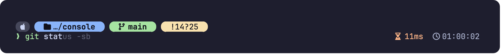
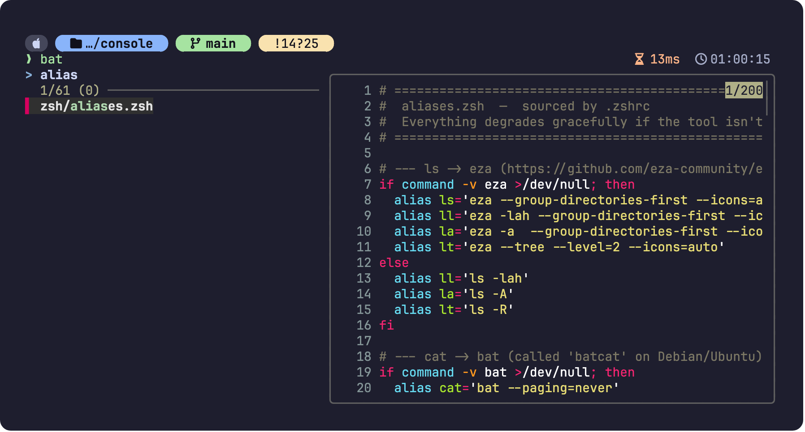
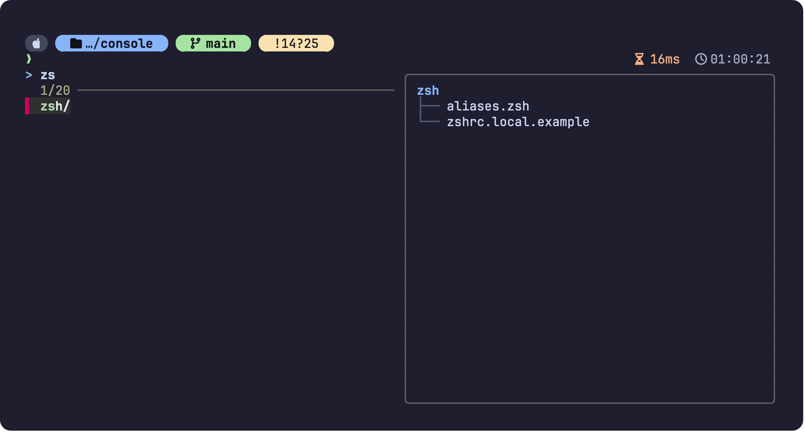
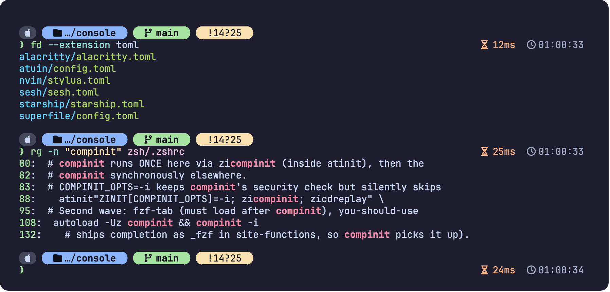
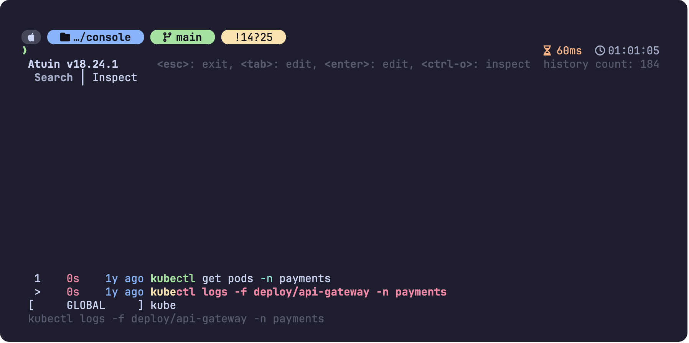
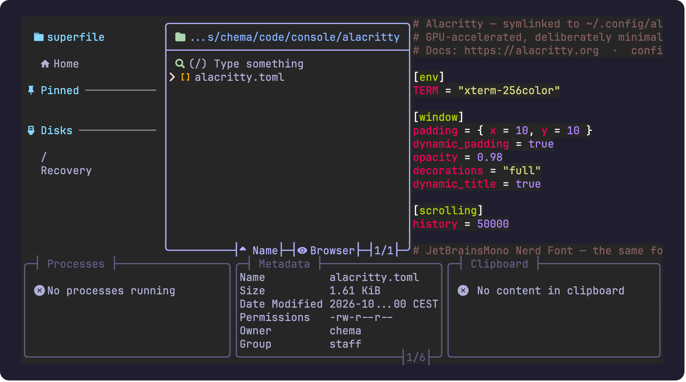
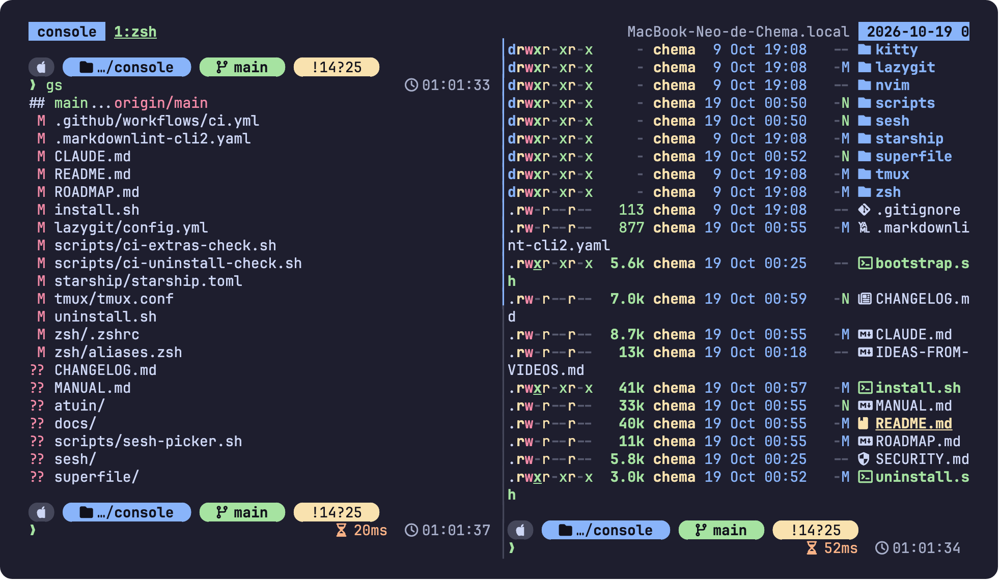
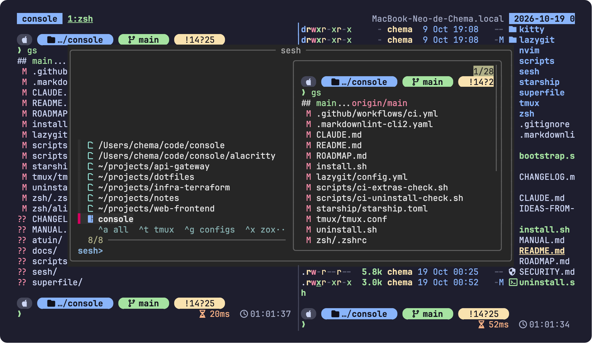
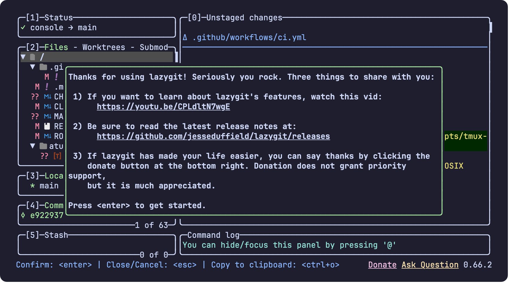
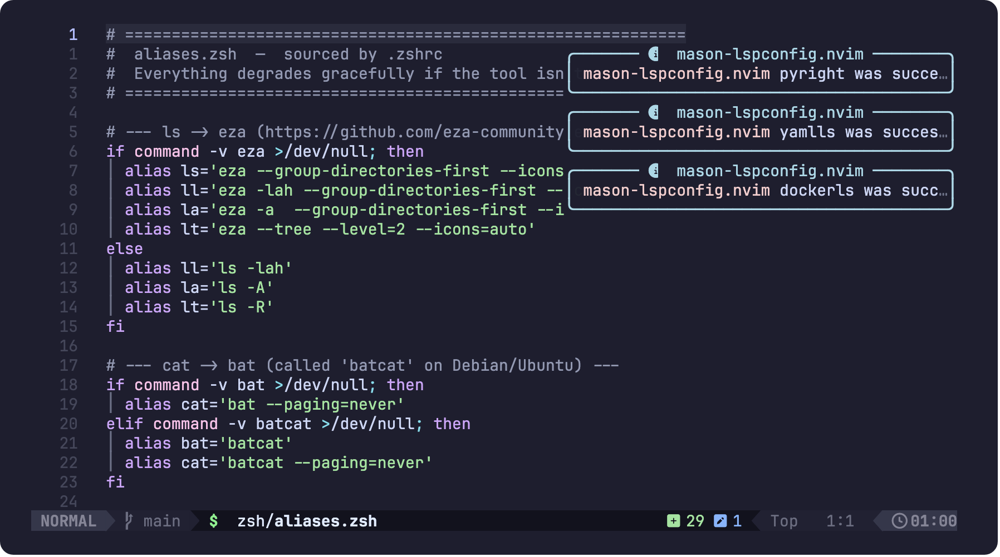

# 📖 console — the manual

Everything the README only hints at, with pictures. The README is the tour; this is
the reference you come back to. Every screenshot is a real capture of this exact
configuration (Ghostty preset, Catppuccin Mocha, JetBrainsMono Nerd Font).

**Contents** ·
[Install](#1-install) ·
[Terminal](#2-the-terminal-ghostty) ·
[Windows/WSL](#21-windows-wsl) ·
[Shell](#3-the-shell-zsh) ·
[Prompt](#4-the-prompt-starship) ·
[Finding things](#5-finding-things-fzf-zoxide-eza-bat-fd-rg) ·
[History](#54-history-atuin) ·
[Files](#55-superfile-a-file-manager-in-the-terminal) ·
[tmux & sesh](#6-tmux-and-sesh-sessions-that-survive) ·
[SSH tunnels](#7-ssh-tunnels) ·
[git](#8-git-aliases-delta-lazygit) ·
[Neovim](#9-neovim-lazyvim) ·
[AI & secrets](#10-ai-and-secrets) ·
[Backups](#11-backups-restore-and-nas) ·
[Per-machine config](#12-per-machine-config-zshrclocal) ·
[Updating](#13-updating-everything) ·
[Troubleshooting](#14-troubleshooting) ·
[Alias reference](#15-full-alias-and-key-reference)


---

## 1. Install

### 1.1 One command

```bash
git clone https://github.com/morandeirachema/console.git ~/code/console
cd ~/code/console
./install.sh            # preview first with ./install.sh --dry-run
exec zsh                # or open a new terminal
```

No `git` yet (fresh VM, container)? `bootstrap.sh` installs git, clones, and hands off:

```bash
curl -fsSLO https://raw.githubusercontent.com/morandeirachema/console/main/bootstrap.sh
less bootstrap.sh       # read it first, as with any installer
sh bootstrap.sh         # accepts every install.sh flag, e.g. sh bootstrap.sh --server
```

### 1.2 What the installer actually does

1. Detects the package manager (brew on macOS; apt / dnf / pacman / zypper on Linux).
2. Installs zsh, starship, fzf, zoxide, eza, bat, fd, ripgrep, delta, tldr, jq, yq, rsync, tmux,
   lazygit, atuin, sesh, superfile, Neovim, the tree-sitter CLI, carapace, direnv, pass, fabric,
   and the JetBrainsMono Nerd Font. Where a distro has no package, lazygit, atuin, sesh,
   superfile, carapace, fabric, Neovim and tree-sitter are fetched as GitHub release binaries
   into `~/.local/bin`, SHA256-verified against the release checksums (the font too); the rest
   just warn.
3. Snapshots every file it is about to replace into `~/backup/zsh/<timestamp>/`.
4. **Symlinks** the repo into place (it never copies), so editing the repo edits your live
   shell:

   | Repo file | Linked to |
   | --------- | --------- |
   | `zsh/.zshrc` | `~/.zshrc` (or `~/.config/zsh/.zshrc` with `--xdg`) |
   | `starship/starship.toml` | `~/.config/starship.toml` |
   | `tmux/tmux.conf` | `~/.config/tmux/tmux.conf` |
   | `ghostty/config` | `~/.config/ghostty/config` |
   | `alacritty/alacritty.toml` · `kitty/kitty.conf` | `~/.config/alacritty/` · `~/.config/kitty/` |
   | `sesh/sesh.toml` | `~/.config/sesh/sesh.toml` |
   | `atuin/config.toml` | `~/.config/atuin/config.toml` |
   | `superfile/config.toml` | `~/.config/superfile/config.toml` (macOS: `~/Library/Application Support/superfile/`) |
   | `lazygit/config.yml` | `~/.config/lazygit/config.yml` (file only, so lazygit's state stays local) |
   | `nvim/` | `~/.config/nvim` (whole directory) |
   | `scripts/sesh-picker.sh` · `scripts/tmux-sessionizer.sh` · `scripts/nas-sync.sh` | `~/.local/bin/sesh-picker` · `tmux-sessionizer` · `nas-sync` |

5. Adds **one** `include.path` line to `~/.gitconfig` pointing at `git/delta.gitconfig`.
   That is the only change outside symlinks, and `uninstall.sh` removes it.
6. Imports your existing zsh history into atuin, once.
7. Changes your login shell to zsh (skipped if it already is, or with `--no-chsh`).
8. Writes an audit log to `~/.local/state/console/install-<timestamp>.log`.

### 1.3 Every flag

| Flag | Effect |
| ---- | ------ |
| `--dry-run` | print every package, symlink and edit the run **would** make; touch nothing |
| `--doctor` | health check: tools, symlinks, font, git include, zinit state. Exits 1 when something needs fixing, so you can script it; `--no-font` / `--no-nvim` / `--no-fabric` mark those as optional |
| `--minimal` | zsh + plugins + prompt + fzf/bat/fd/rg; skips eza, delta, tldr, lazygit, atuin, sesh, spf, jq/yq, direnv, carapace, tmux, pass, fabric, terminals, nvim, font |
| `--server` | headless box: skip the Nerd Font and all terminal configs (they live on your client). WSL does this automatically |
| `--offline` | air-gapped: no network fetches at all; packages must come from your mirror |
| `--xdg` | keep `$HOME` tidy: `.zshrc` goes under `ZDOTDIR=~/.config/zsh` |
| `--no-nvim` | don't install Neovim/LazyVim or touch `~/.config/nvim` |
| `--no-fabric` | skip the fabric AI CLI |
| `--no-ghostty` | don't install Ghostty or link its config |
| `--no-alacritty` · `--no-kitty` | don't link those terminal presets |
| `--no-font` | skip the Nerd Font download |
| `--no-chsh` | leave the login shell alone |
| `-y` / `--yes` | non-interactive |


### 1.4 Uninstall

```bash
./uninstall.sh --dry-run   # list what would be removed, change nothing
./uninstall.sh             # removes only symlinks that point into this repo, the delta include, the --xdg line
```

Packages are left installed (other things may use them). Your pre-install backups stay in
`~/backup/zsh/`. See [Backups](#11-backups-restore-and-nas) to restore the originals.

---

## 2. The terminal (Ghostty)

The terminal is the window; everything else runs inside it. `console` installs
[Ghostty](https://ghostty.org) on desktops and ships a preset for it, plus matching
presets for Alacritty and kitty if you prefer those (linked, not installed).

What the preset sets, and why:

| Setting | Value | Why |
| ------- | ----- | --- |
| font | JetBrainsMono Nerd Font 12 | the same font the installer downloads, so every prompt/tmux/nvim icon renders |
| colours | Catppuccin Mocha, explicit palette | byte-identical to the Alacritty/kitty presets, the prompt, tmux and nvim |
| padding / opacity | 10 px / 0.98 | matches the other presets |
| scrollback | 50 MB | plenty; tmux has its own 50 000-line history |
| cursor | block, no blink | |
| `shell-integration-features` | `cursor,sudo,title,ssh-env,ssh-terminfo` | **the important one, see below** |
| tabs / splits | unbound | tmux owns tabs, splits and sessions |

**Why `ssh-terminfo` matters.** Ghostty sets `TERM=xterm-ghostty`. A server that has never
seen Ghostty has no terminfo entry for it, so `clear`, `less`, `tmux` and vim break with
"unknown terminal". With `ssh-terminfo` on, Ghostty copies its terminfo to the host on your
first `ssh`; with `ssh-env` it falls back to `xterm-256color` where it cannot. Keep both on.

Useful Ghostty keys (macOS `Cmd`, Linux `Ctrl+Shift`): `Cmd+N` new window, `Cmd+,` open the
config, `Cmd+Shift+,` reload it, `Cmd+=`/`Cmd+-` font size, `Cmd+K` clear scrollback.

Validate the preset after editing it:

```bash
ghostty +validate-config          # exit 0 and no output means it is fine
ghostty +show-config | grep font  # see what Ghostty actually resolved
```

Using another terminal? Set its font to **JetBrainsMono Nerd Font** and you are done.

### 2.1 Windows (WSL)

On Windows, `console` runs inside WSL2. The installer detects WSL (`/proc/version` mentions
Microsoft) and behaves like `--server` for the Windows-side pieces:

1. Install WSL and the font on the Windows side, once:

   ```powershell
   wsl --install -d Ubuntu
   winget install DEVCOM.JetBrainsMonoNerdFont
   ```

2. Inside Ubuntu, the normal install: `git clone … ~/code/console && cd ~/code/console && ./install.sh`.
3. The installer skips the Linux font download and the Ghostty/Alacritty/kitty presets, and
   writes a **Windows Terminal fragment** to
   `%LOCALAPPDATA%\Microsoft\Windows Terminal\Fragments\console\console.json`
   (source: `windows-terminal/console.json`). Fragments are additive: you get a
   *Catppuccin Mocha (console)* scheme and a **console (WSL)** profile with the Nerd Font,
   padding and block cursor; your own `settings.json` is untouched. Restart Windows Terminal
   and choose the profile, or apply the scheme and font to your existing Ubuntu profile.
4. WSL-only helpers in the shell: `open <path>` (Explorer), `pbcopy`/`pbpaste` (Windows
   clipboard), `winhome` (cd to `C:\Users\<you>`). tmux copy-mode reaches the Windows
   clipboard through OSC 52 as well.

`--doctor` reminds you about the Windows-side font. Native PowerShell, cmd or Git Bash are
not supported: the installer and the symlink model need a Linux userland.

---

## 3. The shell (zsh)

### 3.1 What happens at startup

`~/.zshrc` finds the repo it lives in, sets a few options, and hands plugin loading to
[zinit](https://github.com/zdharma-continuum/zinit) in *turbo* mode: the prompt appears
instantly and the plugins activate a few milliseconds later, asynchronously. The very first
launch clones zinit and the plugins once (about 10 s); every launch after is instant.

Shell options worth knowing:

| Option | Effect |
| ------ | ------ |
| `AUTO_CD` | typing a directory name alone `cd`s into it |
| `AUTO_PUSHD` | every `cd` pushes onto a stack: `cd -` goes back, `dirs -v` lists it |
| `HIST_IGNORE_SPACE` | a command starting with a **space** is not saved to history (handy for secrets) |
| `SHARE_HISTORY` + `INC_APPEND_HISTORY` | every open shell sees every command immediately |
| `HIST_IGNORE_ALL_DUPS` | history keeps the newest copy of a repeated command |
| `INTERACTIVE_COMMENTS` | `# notes` are allowed on the command line |
| `GLOB_DOTS` | `*` matches dotfiles too |
| `bindkey -e` | emacs line editing: `Ctrl-A`/`Ctrl-E` start/end, `Ctrl-W` delete word, `Alt-B/F` move by word |

History holds 50 000 entries in `~/.zsh_history`, with timestamps.

### 3.2 The plugins

| Plugin | What you get |
| ------ | ------------ |
| zsh-autosuggestions | the rest of a matching past command appears in grey; `→` or `End` accepts it, `Ctrl-→` one word |
| fast-syntax-highlighting | the command line is coloured as you type: green = valid, red = unknown |
| fzf-tab | `Tab` opens a fuzzy, searchable menu with previews instead of a plain list |
| zsh-history-substring-search | `↑`/`↓` cycle only through history matching what you have typed |
| zsh-completions | hundreds of extra completion definitions |
| zsh-you-should-use | prints "You should use: gs" when you type a command that has an alias |
| carapace | value-aware completion for kubectl, aws, docker, terraform, gh… |




### 3.3 Keys

| Key | Does |
| --- | ---- |
| `→` / `End` | accept the autosuggestion (`Ctrl-→` or `Alt-F` = one word) |
| `Tab` | fuzzy completion menu; keep typing to filter; `Ctrl-/` toggles the preview |
| `↑` / `↓` · `Ctrl-P` / `Ctrl-N` | history matching the current prefix |
| `Ctrl-R` | search the whole history (atuin); `Ctrl-R` again cycles host → session → directory |
| `Ctrl-T` | fuzzy pick a file into the line |
| `Alt-C` | fuzzy `cd` into a subdirectory |
| `Ctrl-A` / `Ctrl-E` | start / end of line |
| `Ctrl-U` / `Ctrl-K` | delete to start / end of line |
| `Ctrl-W` | delete the previous word |
| `Ctrl-L` | clear the screen |
| `Ctrl-Z` then `fg` | suspend a program, bring it back |

### 3.4 Completion details

`compinit` runs once, inside zinit's first wave, with `-i`: insecure (world-writable)
completion directories are skipped instead of loaded. Completion is case-insensitive,
coloured like `ls`, and fzf-tab previews directories with `eza`. If zinit cannot be cloned
(offline box) the shell still runs plain `compinit -i`, so Tab always works.

---

## 4. The prompt (starship)

The prompt is a row of rounded pills. **Empty pills vanish**, so a local shell in your home
directory shows almost nothing, while an SSH session into a production cluster shows
everything you need to not make a mistake.

| Pill | Meaning | Appears |
| ---- | ------- | ------- |
| `user` `@host` | who and where; **root is red**, SSH hosts pink | over SSH, as root, or with an unusual user |
| OS icon | the distro / OS | always |
| directory | where you are; repo root in bold, long paths shortened to `…/` | always |
| branch | git branch | in a repo |
| git status | `!` modified · `?` untracked · `+` staged · `»` renamed · `✘` deleted · `≡` stashed · `⇡`/`⇣` ahead/behind · `=` conflicts | when dirty or diverged |
| language | Node / Python / Rust / Go / Java / PHP / C version | in a project of that kind |
| docker | the active docker context | in a directory with a Dockerfile/compose file |
| `☸ context:namespace` | the kubectl context you are pointed at | whenever one is set |
| aws profile/region | the AWS profile you are pointed at | whenever one is set |
| right side | how long the last command took, and the time it finished | always |

The `❯` turns **red** when the previous command failed, so you can tell at a glance.

Colours live in the `[palettes.console]` table of `starship/starship.toml`. To make
production hosts unmistakable, keep a red-accented copy of the file on those boxes and point
`STARSHIP_CONFIG` at it from `~/.zshrc.local`. To show the kubernetes/aws pills only inside
infrastructure directories, uncomment the `detect_*` filters in the same file.

Quick checks:

```bash
starship print-config | head        # the config starship actually loaded
starship explain                    # what each pill is showing right now and why
```

---

## 5. Finding things (fzf, zoxide, eza, bat, fd, rg)

### 5.1 Two fzf keys

`Ctrl-T` and `Alt-C` open [fzf](https://github.com/junegunn/fzf). Type a few letters in order
(not the exact name); `↑`/`↓` to move; `Enter` to pick; `Esc` to cancel; `Ctrl-/` to hide or
show the preview. (`Ctrl-R` is atuin, [section 5.4](#54-history-atuin).)





Under the hood: `Ctrl-T` and `Alt-C` use `fd` (so `.gitignore`d files and `.git/` are
skipped, dotfiles are included); previews use `bat` for files and `eza --tree` for
directories; everything falls back to `cat`/`ls`/`find` on a bare box.

### 5.2 zoxide: `cd` that remembers

Every directory you `cd` into is ranked by how often and how recently you use it.

```bash
z console          # jump to the best match for "console" from anywhere
z code cons        # multiple words narrow it down
zi                 # interactive pick with fzf
z -                # back to the previous directory
```

### 5.3 The upgraded basics

| You type | Runs | Notes |
| -------- | ---- | ----- |
| `ls` · `la` | `eza --icons` · with hidden files | directories first, icons |
| `ll` | `eza -lah --git` | long listing with git status column |
| `lt` | `eza --tree --level=2` | two-level tree |
| `cat file` | `bat --paging=never` | syntax highlighting; `bat -r 10:40 file` for a range, `bat -p` plain |
| `fd pattern` | fd | `fd -e toml` by extension, `fd -t d name` dirs only, `fd -H` include hidden |
| `rg pattern` · `rgi` | ripgrep · case-insensitive | `rg -n` line numbers, `rg -t py`, `rg -l` files only |
| `tldr cmd` | tealdeer | copy-pasteable examples instead of a `man` wall |





### 5.4 History (atuin)

`Ctrl-R` opens [atuin](https://atuin.sh). Instead of grepping a text file it searches a
database of every command you have run, on every host that shares the database, with the
directory, exit code and duration of each. Type a few letters in order; the list narrows.



| In the search | Does |
| ------------- | ---- |
| `Ctrl-R` again | cycle the filter: all → this host → this session → this directory |
| `↑` / `↓` | move; `Ctrl-O` opens the inspector (when, where, exit code, duration) |
| `Enter` | put the command on your line **to review**; it does not run |
| `Tab` | also puts the command on your line to edit (same as Enter with `enter_accept = false`) |
| `Esc` | back to whatever you had typed |

What is deliberately **not** recorded: lines that start with a space (same rule as
`HIST_IGNORE_SPACE`) and anything the secrets filter recognises (AWS keys, GitHub and Slack
tokens, and similar). Nothing is sent anywhere: `auto_sync` and `update_check` are off.
To sync between machines, `atuin register`/`atuin login` once and set `auto_sync = true` in
`~/.zshrc.local`-managed config; the server can be self-hosted.

From the shell: `h` opens the same search, `hstats` lists your most-used commands,
`atuin history list --cmd-only | tail` prints the last few. Your pre-existing history was
imported once by the installer (`atuin import zsh` repeats it). `↑`/`↓` are untouched: they
still cycle matching history the plain way.

### 5.5 superfile: a file manager in the terminal

`spf` (or `fm`) opens [superfile](https://superfile.dev): a two-pane file manager with
previews, themed to match. Quit with `q` and your shell `cd`s to wherever you ended up.



| Key | Does | Key | Does |
| --- | ---- | --- | ---- |
| `↑` `↓` / `j` `k` | move | `Enter` / `l` | open directory or file |
| `h` / `Backspace` | parent directory | `v` | select mode (`J`/`K` extend, `A` select all) |
| `Ctrl-c` · `Ctrl-x` · `Ctrl-v` | copy · cut · paste | `Ctrl-d` | delete (to trash) |
| `Ctrl-r` | rename | `Ctrl-n` | new file (end the name with `/` for a folder) |
| `/` | search in the panel | `f` · `.` · `o` | toggle preview · dotfiles · sort menu |
| `Ctrl-p` · `P` | copy the path · pin the directory | `e` | open in `$EDITOR` |
| `Tab` · `q` | next panel · quit | `?` | all keys |

Previews use `bat`; `e` opens the file in `$EDITOR` (nvim). The config is
`superfile/config.toml`; themes live in superfile's own theme directory.

---

## 6. tmux and sesh: sessions that survive

### 6.1 Why

Close the window, lose the SSH connection, reboot: without tmux everything you were running
dies. tmux keeps your terminals alive in a background server; you **attach** and **detach**
at will. It also splits a window into panes. Sessions are named, one per project.

```text
tmux server                       one background process; survives disconnects and logouts
└─ session   "console"            a named workspace, usually one per project
   ├─ window  1: edit             like a browser tab
   │  ├─ pane  nvim               a split within the window
   │  └─ pane  a shell
   └─ window  2: logs
```



### 6.2 Keys

The **prefix** is `Ctrl-b` (default). Press it, release, then press the key.

| Key | Does |
| --- | ---- |
| `prefix f` | **project picker** (sesh, or the sessionizer where sesh is absent): fuzzy-pick a project, jump to its session |
| `prefix \|` · `prefix -` | split vertically · horizontally, keeping the current directory |
| `prefix c` | new window in the current directory |
| `prefix n` · `prefix p` · `prefix 1..9` | next · previous · nth window |
| `prefix h j k l` | move between panes |
| `Alt` + arrows | move between panes **without** the prefix |
| `prefix H J K L` | resize the pane by 5 (hold to repeat) |
| `prefix z` | zoom the pane to full screen and back |
| `prefix x` | kill the pane |
| `prefix d` | detach (everything keeps running) |
| `prefix s` · `prefix S` | switch session from a list · flip back to the previous session |
| `prefix $` | rename the session |
| `prefix [` | copy mode (vi keys): `v` select, `Ctrl-v` block, `y` copy, `q` leave |
| `prefix Ctrl-s` · `prefix Ctrl-r` | save · restore the layout by hand (resurrect) |
| `prefix r` | reload `tmux.conf` |

Mouse is on: click a pane, drag a border, scroll the history. Copy mode copies to the system
clipboard through OSC 52, which works over SSH too.

From the shell: `t` (tmux), `ta` (attach), `tls` (list), `tmux attach -t name`, `tmux kill-session -t name`.

### 6.3 sesh: the project picker

[sesh](https://github.com/joshmedeski/sesh) is a session manager that merges three sources
into one fuzzy list: running tmux sessions, directories zoxide knows about, and sessions you
declared in `sesh/sesh.toml`. Pick one and `sesh connect` attaches to it, creating it first
if needed. That is why `prefix f` works for a project you have never opened in tmux: zoxide
already knows the directory because you `cd`ed into it once.



| In the picker | Does |
| ------------- | ---- |
| type | filter the list |
| `Ctrl-a` / `Ctrl-t` / `Ctrl-g` / `Ctrl-x` | show all / only tmux sessions / only configured / only zoxide dirs |
| `Ctrl-d` | kill the highlighted tmux session |
| `Enter` | connect |

From the shell: `proj` opens the same picker; `proj api` connects straight to the session or
directory best matching "api"; `sesh last` flips to the previous session; `sesh list` prints
the sources. Declare a project with a startup command and windows in `sesh/sesh.toml`:

```toml
[[session]]
name = "console"
path = "~/code/console"
startup_command = "nvim README.md"
```

Where sesh is not installed (an old server), `prefix f` falls back to the original
`tmux-sessionizer` script, which fuzzy-finds a project under `~/code ~/projects ~/src ~/work
~/dev` (override with `TMUX_SESSIONIZER_PATHS` in `~/.zshrc.local`).

### 6.4 Surviving reboots

tmux-resurrect and tmux-continuum auto-save the session/window/pane layout every 15 minutes
and restore it when the tmux server starts. Pane *contents* are deliberately not saved, so
scrollback with secrets never touches disk. Running programs are restored as their command
lines (nvim, less, tail…), not their state. The plugins are installed by `install.sh` into
`~/.tmux/plugins/`; `prefix I` (capital i) installs or updates them by hand.

---

## 7. SSH tunnels

Three helpers wrap the `ssh -L / -R / -D` flags. Each runs in the foreground with a
keep-alive and prints what it is doing; `Ctrl-C` closes it. Open them in a tmux pane.

| Helper | Direction | Example |
| ------ | --------- | ------- |
| `fwd <host> <port>` | remote `localhost:<port>` → your `localhost:<port>` | `fwd db01 5432` then connect to Postgres at `localhost:5432` |
| `fwd <host> <lport> <rport>` | same, different local port | `fwd db01 15432 5432` |
| `fwd <host> <lport> <rhost> <rport>` | reach a third host *through* `<host>` | `fwd bastion 8080 10.0.0.9 80` |
| `rfwd <host> <rport> [lport]` | expose **your** local service on the remote | `rfwd server 9000 3000` |
| `socks <host> [port]` | SOCKS5 proxy via the host (default port 1080) | `socks jump`, then point the browser at `localhost:1080` |

Keep host aliases out of the repo: add `Include ~/.ssh/config.local` at the top of
`~/.ssh/config` and put `Host` blocks in that `chmod 600` file. Then `fwd db01 5432` works by
name. `GPG_TTY` is exported so gpg (and git signing) can prompt inside the terminal.

---

## 8. git: aliases, delta, lazygit

| Alias | Runs | Alias | Runs |
| ----- | ---- | ----- | ---- |
| `g` | `git` | `gd` | `git diff` |
| `gs` | `git status -sb` | `gco` · `gb` | checkout · branch |
| `ga` | `git add` | `gl` | graph log, last 20 |
| `gc` · `gca` | commit · commit -a | `gla` | graph log, all branches |
| `gp` · `gpl` | push · pull | `lg` | **lazygit** |

**delta** is the pager for `git diff`, `git show`, `git log -p` and `git blame`: syntax
highlighting, line numbers, `n`/`N` to jump between files, moved-code colouring, and
`zdiff3` conflict markers. It is wired in through a single `include.path` line in
`~/.gitconfig`, so your own git settings are untouched.


**lazygit** (`lg`) is a full-screen git UI. Panels: status, files, branches, commits, stash.



| Key | Does | Key | Does |
| --- | ---- | --- | ---- |
| `Tab` · `←` `→` · `1-5` | move between panels | `c` · `A` | commit · amend last commit |
| `Space` | stage / unstage the file (or branch: checkout) | `p` · `P` · `f` | pull · push · fetch |
| `Enter` on a file | stage individual lines and hunks | `n` · `d` · `M` · `r` | branch: new · delete · merge · rebase |
| `a` | stage all | `s` | stash |
| `e` · `o` | edit · open the file | `z` · `Ctrl-z` | undo · redo |
| `?` | every key for the current panel | `q` | quit |

Diffs inside lazygit go through delta too (`lazygit/config.yml`), so they look the same.

---

## 9. Neovim (LazyVim)

`vi`, `vim` and `v` all open Neovim, and it is `$EDITOR`, so git commit messages open here.
The configuration is [LazyVim](https://www.lazyvim.org): plugins install themselves on first
launch (about a minute), and `nvim/lazy-lock.json` pins their versions on every machine.



### 9.1 Modes in thirty seconds

- **Normal** (default): keys move and edit. `h j k l` move, `w`/`b` by word, `0`/`$` line
  start/end, `gg`/`G` file top/bottom, `dd` delete line, `yy` copy line, `p` paste, `u` undo,
  `Ctrl-r` redo, `.` repeat.
- **Insert**: `i` (or `a` after the cursor, `o` new line below). `Esc` returns to Normal.
- **Visual**: `v` select characters, `V` lines, `Ctrl-v` block; then `d`, `y`, `>`…
- **Command**: `:w` save, `:q` quit, `:wq` both, `:q!` quit without saving, `:e file` open.

### 9.2 The LazyVim keys you need

The leader is `Space`. Press it and wait: which-key shows every option.

| Key | Does | Key | Does |
| --- | ---- | --- | ---- |
| `Space Space` | find files | `Space e` | file explorer |
| `Space /` | grep the project | `Space ,` | switch buffer |
| `Space gg` | lazygit | `Space gd` / `Space gb` | git diff / blame |
| `gd` · `gr` · `K` | definition · references · docs | `Space ca` · `Space cr` | code action · rename |
| `Space cf` | format file | `Space xx` | diagnostics list |
| `Shift-h` · `Shift-l` | previous · next buffer | `Space bd` | close buffer |
| `Space l` | plugin manager (update with `U`) | `Space cm` | Mason: install language servers |
| `Space uC` | pick a colorscheme | `Space sk` | search keymaps |

Language extras enabled: Docker, Terraform, YAML, JSON, Markdown, Python. Add more with
`:LazyExtras`, and your own plugins as files under `nvim/lua/plugins/`.

---

## 10. AI and secrets

- **fabric** runs AI prompt "patterns" as Unix filters. One-time `fabric --setup`; keep the
  API key in `~/.zshrc.local`. Then `cat notes.md | fsum`, `git diff | fexplain`,
  `ytsum <youtube-url>`, or `fab --pattern <name>` for any of the 200+ patterns.
- **pass** stores each secret GPG-encrypted under `~/.password-store`, with **your** key.
  `gpg --gen-key` once, `pass init <key-id>`, then `pass insert site/login`, `pw site/login`
  to print, `pwc site/login` to copy, `passf` to fuzzy-pick and copy. The store is a git repo
  if you `pass git init`, and `nas-sync` backs it up.

Remember `HIST_IGNORE_SPACE`: start a command with a space and it never enters history.

---

## 11. Backups, restore and NAS

### 11.1 What is backed up

Before a real run (never `--dry-run`/`--doctor`), the installer copies every file it is
about to replace, plus `~/.gitconfig` and `~/.zshenv`, into `~/backup/zsh/<timestamp>/`.

### 11.2 Restore one file or everything

```bash
b=$(ls -1dt ~/backup/zsh/*/ | head -1)      # newest backup
ls -la "$b"
rm -f ~/.zshrc && cp -a "$b/.zshrc" ~/.zshrc  # one file: unlink first, then copy
./uninstall.sh && cp -a "$b/." ~/             # everything
exec zsh
```

Always remove the symlink before copying over it; copying onto a live symlink writes
through to the repo file.

### 11.3 nas-sync

`nas-sync` rsyncs `~/backup` and `~/.password-store` to any rsync target. It is additive
(never deletes on the destination). Configure once in `~/.zshrc.local`:

```bash
export NAS_DEST="/mnt/nas/backups/$(hostname)"        # a mounted SMB share (Synology)
# export NAS_DEST="user@nas:/volume1/backups"          # or an ssh target
# export NAS_SYNC_PATHS="$HOME/backup $HOME/notes"      # optional override
```

```bash
nas-sync -n     # preview
nas-sync        # sync
```

The SMB mount recipe is in `zsh/zshrc.local.example`. Schedule it from cron if you like.

---

## 12. Per-machine config (`~/.zshrc.local`)

Anything secret or specific to one machine goes in `~/.zshrc.local`. It is sourced last,
only if **you** own it, and never committed. Start from the example:

```bash
cp zsh/zshrc.local.example ~/.zshrc.local && chmod 600 ~/.zshrc.local
```

What people put there:

| Need | Line |
| ---- | ---- |
| work PATH | `export PATH="$HOME/tools/bin:$PATH"` |
| API keys | `[ -r ~/.secrets/env ] && source ~/.secrets/env` (a 0600 file) |
| production prompt accent | `export STARSHIP_CONFIG=~/.config/starship.prod.toml` |
| project roots for the sessionizer fallback | `export TMUX_SESSIONIZER_PATHS="$HOME/code $HOME/work"` |
| NAS target | `export NAS_DEST=...` |
| a plain ssh-agent when the platform has none | the commented block in the example |

One exception: `ZINIT_PIN` must go in `~/.zshenv`, because `.zshrc.local` is sourced after zinit
has already cloned itself.
| host aliases | `alias vpn='sudo openvpn --config ~/work/vpn.conf'` |

Editor settings go in `nvim/lua/config/*.lua`; terminal tweaks in `ghostty/config`;
prompt tweaks in `starship/starship.toml`. Those are repo files, so they travel with you.

---

## 13. Updating everything

```bash
cd ~/code/console && git pull && exec zsh      # the configs are symlinks: that is the update
./install.sh                                    # only needed when a new tool was added
```

| What | Command |
| ---- | ------- |
| zsh plugins | `zinit self-update && zinit update --all` |
| LazyVim plugins | `nvim` → `:Lazy update`, then commit `nvim/lazy-lock.json` |
| tmux plugins | inside tmux: `prefix U` |
| CLI tools | `brew upgrade` / `apt upgrade` / `dnf upgrade` / `pacman -Syu` |
| tldr pages | `tldr --update` |
| check the result | `./install.sh --doctor` |


---

## 14. Troubleshooting

| Symptom | Cause and fix |
| ------- | ------------- |
| boxes or `?` instead of icons | the terminal is not using a Nerd Font; set it to JetBrainsMono Nerd Font (`fc-list \| grep -i jetbrains` to confirm it is installed). On WSL the font must be installed on **Windows** and selected in Windows Terminal |
| no suggestions / colours, plain Tab | zinit never cloned (offline). `./install.sh --doctor` shows it; `rm ~/.local/share/zinit/.clone-failed` and open a new shell |
| `Ctrl-T` / `Alt-C` do nothing | fzf is too old or its key-bindings file is missing; `fzf --version` ≥ 0.48 fixes it, or install the distro's `fzf` package fully |
| `bat`/`fd` "command not found" on Debian | they are `batcat`/`fdfind` there; the aliases handle it once the shell is reloaded |
| over SSH: "unknown terminal xterm-ghostty" | Ghostty's `ssh-terminfo` feature could not copy the terminfo; run `infocmp -x xterm-ghostty \| ssh host tic -x -`, or `export TERM=xterm-256color` for that session |
| `Alt-C`, `Alt-F` or tmux `Alt`+arrows type `ç`/`ƒ` on macOS | the terminal sends Option as a dead key; the shipped Ghostty/Alacritty/kitty presets set Option-as-Alt, so reload the config or set it in your own terminal (Terminal.app: Profiles → Keyboard → Use Option as Meta) |
| wrong colours inside tmux | the outer terminal must advertise truecolor; check `tmux info \| grep Tc` and that `TERM` outside tmux is `xterm-256color` or `xterm-ghostty` |
| slow shell start | `zinit times` shows plugin load times; `zsh -xv 2>&1 \| ts` finds a slow line in `~/.zshrc.local` |
| `compinit: insecure directories` | a completion dir is group/world-writable; `compaudit` lists them, `chmod g-w,o-w <dir>` fixes them. The shell already skips them (`-i`) |
| `git diff` shows no colours | the delta include is missing: `git config --global --get-all include.path`, or rerun `./install.sh` |
| `prefix f` says fzf is required | install fzf (or run `./install.sh`); sesh needs zoxide as well |
| Neovim: "treesitter parser failed to build" | the tree-sitter CLI or a C compiler is missing; on macOS `xcode-select --install`, then `:TSUpdate` |
| I want the old setup back | `./uninstall.sh`, then restore from `~/backup/zsh/<timestamp>/` ([section 11](#11-backups-restore-and-nas)) |

---

## 15. Full alias and key reference

Aliases exist only when the tool is installed, so a bare box never gets a broken alias.

**Files**: `ls` `la` `ll` `lt` (eza) · `cat` (bat) · `fd` · `rgi` (`rg -i`) · `tldr` · `spf` `fm` (superfile)

**History**: `Ctrl-R` · `h` (atuin search) · `hstats`

**Navigation**: `..` `...` `....` · `z` `zi` (zoxide) · `path` (PATH, one per line)

**git**: `g` `gs` `ga` `gc` `gca` `gp` `gpl` `gd` `gco` `gb` `gl` `gla` · `lg` (lazygit)

**tmux / sesh**: `t` `ta` `tls` · `proj [name]` (sesh picker / connect) · `sl` (sesh list) · `tmux-sessionizer`

**Editor**: `v` `vi` `vim` (nvim) · `zshrc` (edit `~/.zshrc`) · `reload` (`exec zsh`)

**Kubernetes**: `k` `kg` `kd` `klo` (logs -f) · `kx` (switch context) · `kns` (switch namespace)

**Docker / IaC**: `d` `dps` `dc` (compose) · `tf` (terraform) · `ap` (ansible-playbook)

**systemd**: `sc` `scu` (systemctl, --user) · `jc` `jcu` (journalctl, --user)

**Network**: `fwd` `rfwd` `socks` (tunnels) · `myip` · `ports` (listening ports)

**Secrets / AI**: `pw` `pwc` `passf` (pass) · `fab` `fsum` `fexplain` `ytsum` (fabric)

**Handy**: `please` (rerun the last command with sudo) · `nas-sync [-n]` · `grep`/`egrep` coloured

### 15.1 Keys at a glance

| Context | Key | Does |
| ------- | --- | ---- |
| shell | `→` | accept suggestion |
| shell | `Ctrl-R` | atuin history search |
| shell | `Tab` | fuzzy completion |
| shell | `Ctrl-T` · `Alt-C` | file · directory picker |
| shell | `Ctrl-/` | toggle a picker's preview |
| tmux | `prefix f` | project picker (sesh) |
| tmux | `prefix \|` `-` · `Alt`+arrows | split · move between panes |
| tmux | `prefix d` · `prefix [` | detach · copy mode |
| lazygit | `Space` · `c` · `P` · `?` | stage · commit · push · help |
| nvim | `Space` | which-key: discover everything |
| nvim | `Esc` `:q!` `Enter` | get out without saving |
